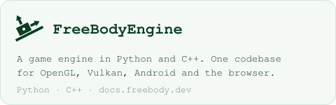
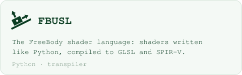

<!-- The SVGs here are drawn by build.py - edit that and rerun it, rather than the SVGs. -->
<a href="https://freebody.dev">
  <picture>
    <source media="(prefers-color-scheme: dark)" srcset="card-dark.svg">
    
  </picture>
</a>

<a href="https://github.com/ollie80/FreeBodyEngine"><picture><source media="(prefers-color-scheme: dark)" srcset="engine-dark.svg"></picture></a>
<a href="https://github.com/ollie80/FBUSL"><picture><source media="(prefers-color-scheme: dark)" srcset="fbusl-dark.svg"></picture></a>
